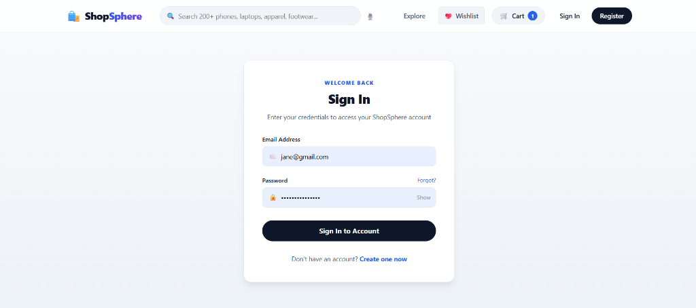
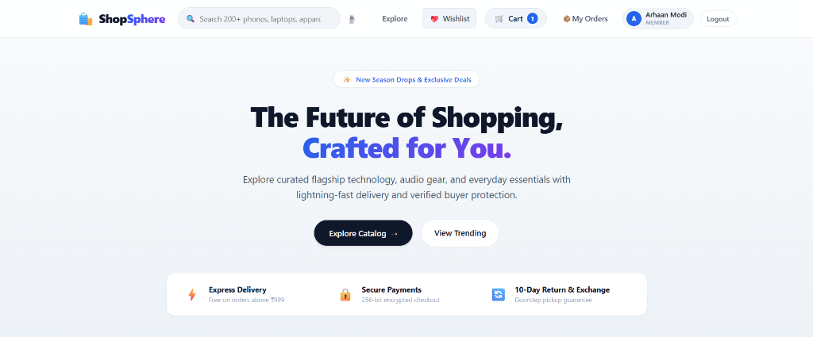
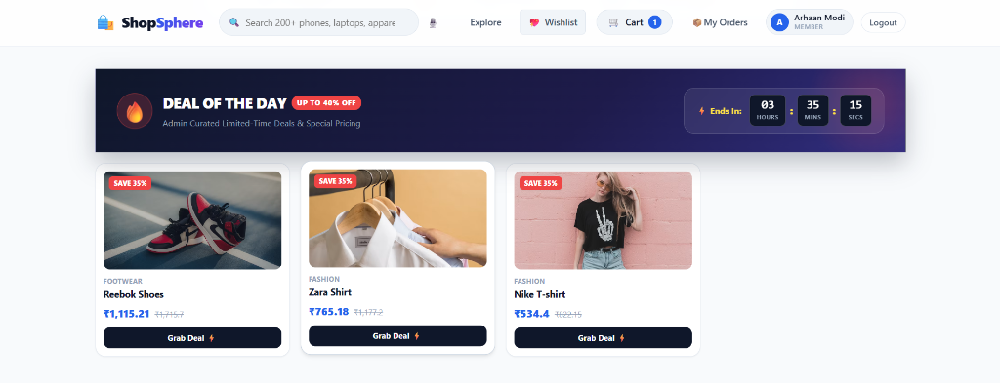
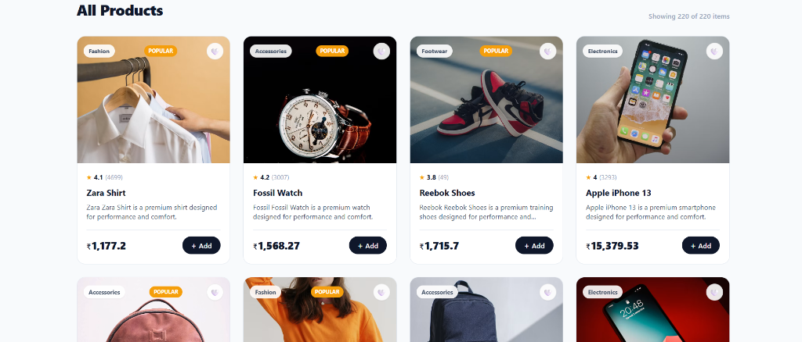
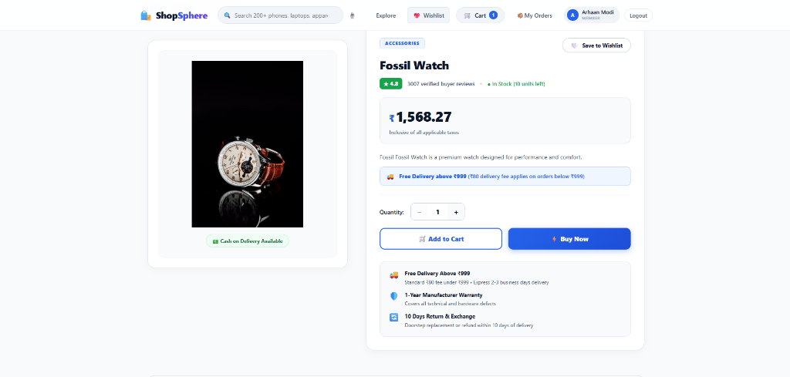

# 🛍️ ShopSphere - Modern Full-Stack E-Commerce Platform

ShopSphere is a full-featured, next-generation e-commerce web platform engineered with **React 19 + TypeScript + Vite** on the frontend and **FastAPI + PostgreSQL / SQLAlchemy** on the backend.

---

## 📸 Screenshots & Showcase

### 1. Secure Authentication & User Sign In
Clean modal card authentication with password show/hide toggle and instant access.


---

### 2. Storefront Hero & Trust Assurances
Modern headline, interactive search bar, quick voice filter, member badge, cart counter, and 10-Day Return & Exchange assurance.


---

### 3. Deal of the Day & Live Flash Deals
Admin-curated limited-time flash discounts with real-time countdown timer.


---

### 4. Categorized Product Grid & Ratings
Responsive multi-column catalog with category labels, popular badges, star reviews count, and quick Add to Cart.


---

### 5. Structured Product Details & Wishlist
2-column layout with sticky image gallery, COD verification badge, interactive wishlist button, quantity stepper, free delivery rules, and inline review composer.


---

## 🌟 Key Features

### 🛒 Customer Experience
- **Interactive Catalog**: 200+ curated items across Electronics, Fashion, Footwear, and Accessories.
- **Deal of the Day**: Dynamic countdown timers with live discounted pricing.
- **Wishlist System**: One-click heart toggle with saved state and drawer preview.
- **Cart & Dynamic Delivery Pricing**: Free delivery on orders above ₹999; ₹80 fee for orders below ₹999.
- **24-Hour Easy Cancellation**: Customers can cancel unprocessed orders within 24 hours of placement directly from their dashboard.
- **10-Day Post-Delivery Return & Exchange**: Customer self-service portal to request Doorstep Exchange or Full Return & Refund with specific reasons and comments.
- **Verified Buyer Reviews & Ratings**: Star breakdown bars and inline review composer on product pages.
- **Official GST Tax Invoice**: Formatted invoice modal with printable sheet, itemized breakdown, CGST/SGST taxes, barcode, and paid stamp.

### 🛡️ Admin Dashboard & Control Center
- **Order Lifecycle Management**: Live status tracking from `Order Received` → `Shipped` → `Out for Delivery` → `Delivered`.
- **Dedicated Returns & Exchanges Portal**: Real-time KPI counter, filter tabs with alert badges, customer return reason details, and one-click **Approve Return & Refund ✓** / **Approve Exchange ✓** / **Reject ✕** controls.
- **Inventory & Catalog Control**: Out-of-stock toggles, inline stock quantity updates, and dynamic price edits.
- **Coupon Code Engine**: Percentage and flat discount coupons with minimum order amount requirements and expiry countdown timers.
- **Flash Deals Manager**: Admin can promote any catalog item to Deal of the Day with custom discount percentage and duration.
- **CSV Orders Export**: Export complete ledger with customer details, shipping addresses, payment methods, and totals.

---

## 🛠️ Tech Stack

- **Frontend**: React 19, TypeScript, Vite, React Router v7, Vanilla CSS3 with Modern Variables & Responsive Grids.
- **Backend**: Python 3.11+, FastAPI, SQLAlchemy ORM, Pydantic v2, PostgreSQL / SQLite.
- **Security**: JWT Authentication, bcrypt password hashing, CORS middleware.

---

## 🚀 Getting Started

### 1. Clone Repository
```bash
git clone https://github.com/<your-username>/shophere.git
cd shophere
```

### 2. Backend Setup
```bash
cd backend
python -m venv venv
# Windows:
.\venv\Scripts\activate
# macOS/Linux:
source venv/bin/activate

pip install -r requirements.txt
uvicorn app.main:app --reload --port 8000
```

### 3. Frontend Setup
```bash
cd ../frontend
npm install
npm run dev
```
Open `http://localhost:5173` in your browser.
