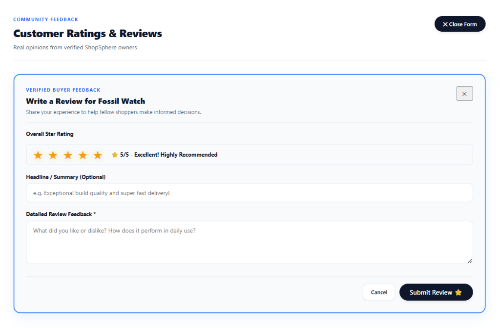
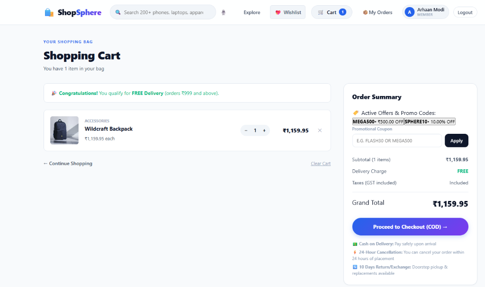
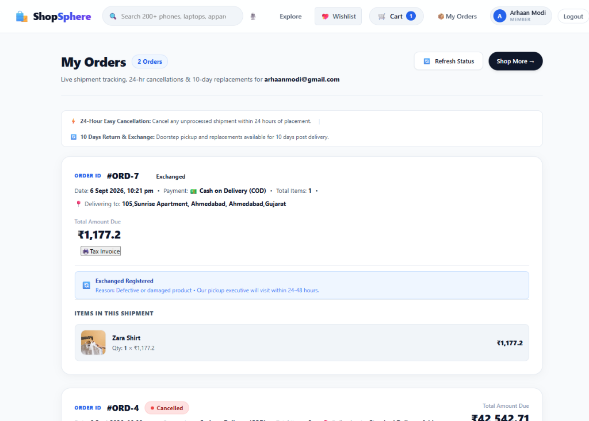
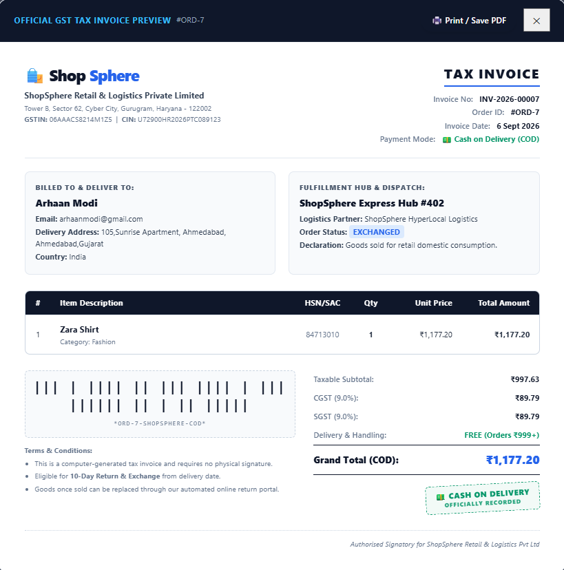
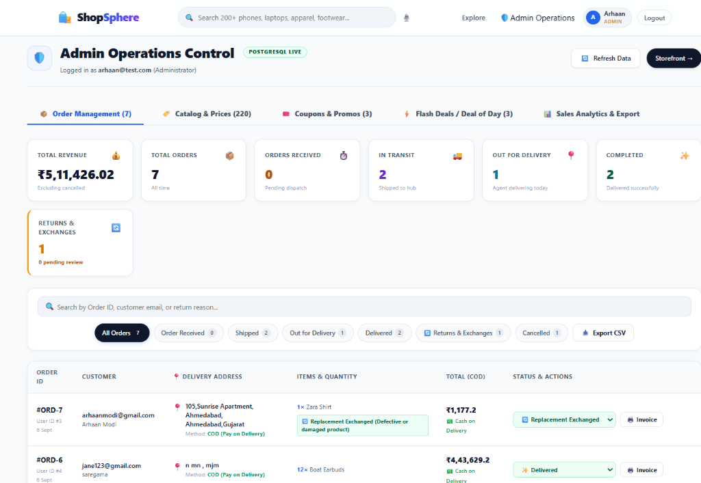
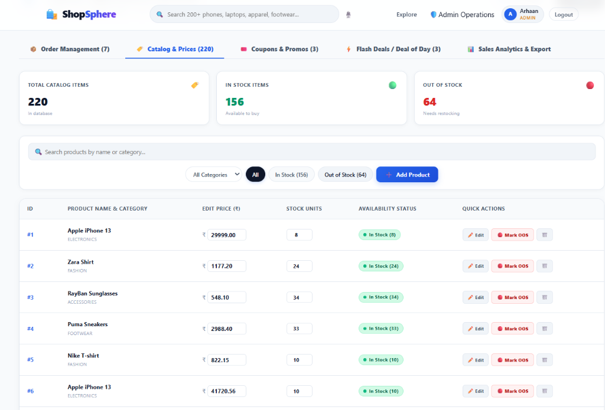
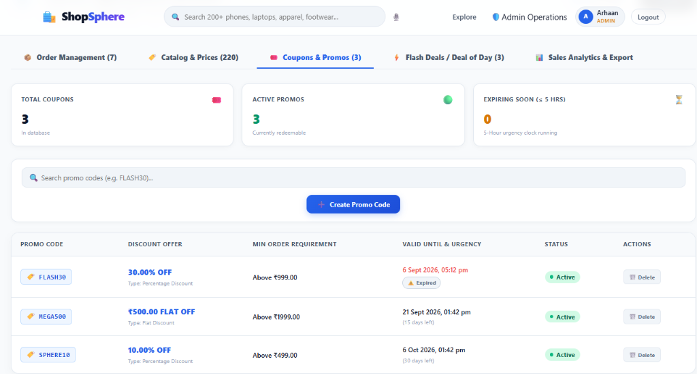
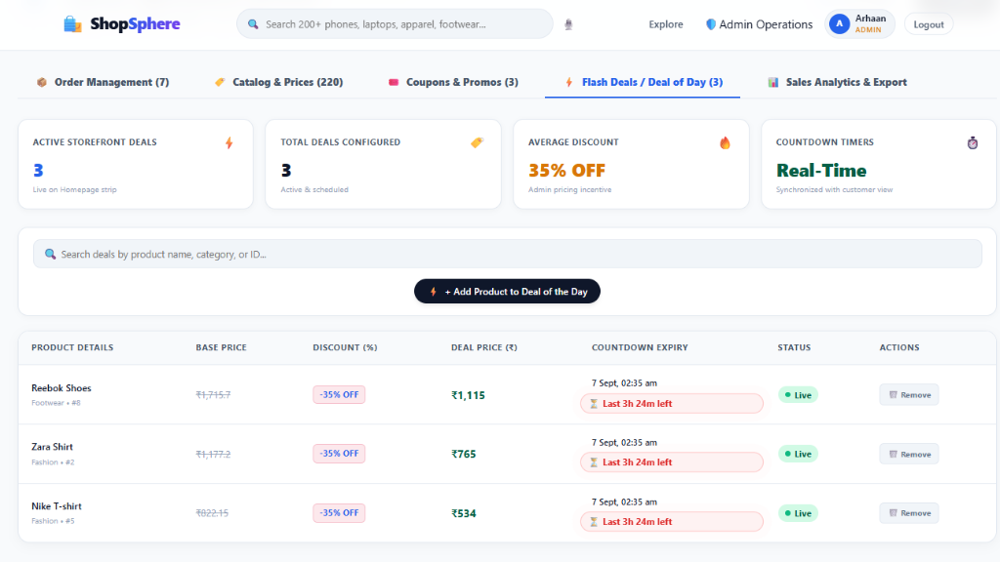
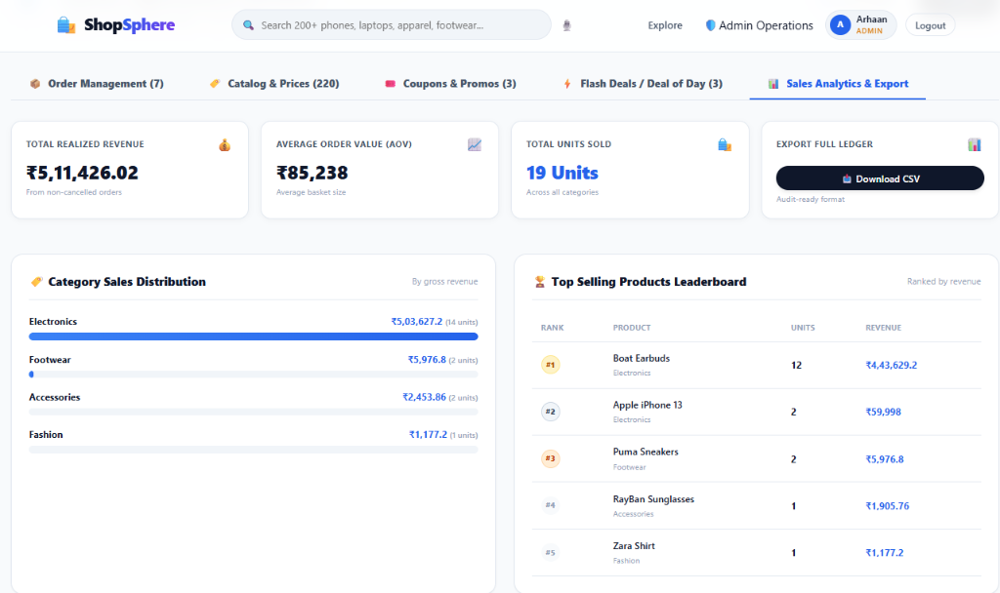

# 🛍️ ShopSphere - Complete Full-Stack E-Commerce Platform

ShopSphere is a full-featured, next-generation e-commerce web platform engineered with **React 19 + TypeScript + Vite** on the frontend and **FastAPI + PostgreSQL / SQLAlchemy** on the backend.

---

## 📸 Complete Visual Showcase (All 14 Features)

### 1. Secure Authentication & User Sign In
Clean modal card authentication with password show/hide toggle, JWT authentication, and member session persistence.


---

### 2. Storefront Hero & Trust Assurances
Modern headline, interactive live search bar, quick voice filter, member badge, cart counter, and 10-Day Return & Exchange doorstep assurance.


---

### 3. Deal of the Day & Live Flash Deals
Admin-curated limited-time flash discounts with real-time countdown timer, dynamic percentage savings, and discounted checkout.


---

### 4. Categorized Product Grid & Ratings
Responsive multi-column catalog with category labels, popular badges, verified star ratings count, and quick Add to Cart.


---

### 5. Structured Product Details & Wishlist
2-column layout with sticky image viewport, COD verification badge, interactive wishlist button (`🤍 Save to Wishlist` ⟷ `❤️ In Wishlist`), quantity stepper, free delivery policy rules, and guarantee perks.


---

### 6. Inline Verified Customer Reviews
Interactive 5-star rating selector with real-time descriptive feedback hints, title/summary input, detailed comments, and instantaneous feedback publishing directly inline.


---

### 7. Shopping Cart, Dynamic Delivery & Promo Codes
Visual shopping bag with free delivery qualification tracker (Free delivery above ₹999; ₹80 fee under ₹999), promotional coupon code engine (`MEGA500`, `SPHERE10`), GST breakdown, and COD checkout.


---

### 8. My Orders, Tracking & 10-Day Replacements
Real-time shipment tracking stepper, 24-hour cancellation window indicator, doorstep delivery address display, items breakdown, and self-service 10-day post-delivery Return/Exchange resolution portal.


---

### 9. Official GST Tax Invoice & Print Engine
Standardized GST Tax Invoice modal with two-column layout (Billed To vs. Fulfillment Hub), HSN/SAC codes, CGST/SGST (9% + 9%) itemized calculation, barcode strip, terms & conditions, and Cash on Delivery stamp.


---

### 10. Admin Order Management & Return/Exchange Center
Live PostgreSQL control center with real-time KPI metrics (Total Revenue, Orders Received, In Transit, Out for Delivery, Completed, Returns & Exchanges), status dropdowns, search by return reason, and one-click **Approve Return & Refund ✓** / **Approve Exchange ✓** / **Reject ✕** controls.


---

### 11. Admin Catalog, Dynamic Pricing & Stock Control
Complete inventory management with instant inline price adjustments, stock quantity steppers, Out-of-Stock toggles (`Mark OOS`), category filters, and an **Add Product** modal.


---

### 12. Admin Coupons & Promotions Engine
Coupon creator supporting percentage (%) and flat (₹) discounts, custom minimum order values, active promo status toggling, and 5-hour expiration urgency countdown clocks.


---

### 13. Admin Flash Deals & Deal of the Day Manager
Promote any catalog product to Deal of the Day with customized discount percentages, automatic deal pricing calculations, and live synchronized countdown clocks with customer storefronts.


---

### 14. Admin Sales Analytics & Audit CSV Export
Comprehensive sales analytics displaying Total Realized Revenue, Average Order Value (AOV), Total Units Sold, Category Revenue Distribution bar charts, Top-Selling Products Leaderboard, and one-click **Download CSV** audit exports.


---

## 🌟 Complete Feature Matrix

| Category | Feature | Description |
|---|---|---|
| **Storefront** | 200+ Products Catalog | Electronics, Fashion, Footwear, and Accessories with real-time stock tracking |
| **Storefront** | Deal of the Day | Timed flash sales with custom discount percentages and countdown timers |
| **Storefront** | Interactive Wishlist | One-click heart toggle with saved state and navigation count badge |
| **Checkout** | Dynamic Delivery Fees | Free delivery on orders ≥ ₹999; flat ₹80 fee on orders < ₹999 |
| **Checkout** | Coupon Discount Engine | Percentage (%) or Flat (₹) promo codes with minimum order amount restrictions |
| **Post-Order** | 24-Hour Easy Cancellation | One-click cancellation within 24 hours of placement directly from order history |
| **Post-Order** | 10-Day Return & Exchange | Self-service portal to request Doorstep Replacement or Return & Refund with reasons |
| **Post-Order** | GST Tax Invoice | Printable/downloadable official invoice with itemized tax and barcode |
| **Feedback** | Verified Buyer Reviews | 5-star rating breakdown bars and inline review composer |
| **Admin** | Order Management | Full lifecycle tracking (`Order Received` → `Shipped` → `Out for Delivery` → `Delivered`) |
| **Admin** | Return & Exchange Center | Dedicated KPI, filter tabs, customer reason callouts, and one-click resolution approvals |
| **Admin** | Catalog & Stock Control | In-line price updates, stock units counters, and Out-of-Stock toggles |
| **Admin** | Coupon Code Engine | Create and manage custom discount codes with minimum order thresholds and timers |
| **Admin** | Flash Deals Manager | Add/pause/delete live deals with custom discount percentages and end dates |
| **Admin** | Sales Analytics & CSV Export | Real-time gross revenue, AOV, category graphs, leaderboard, and CSV download |

---

## 🛠️ Tech Stack & Architecture

- **Frontend**: React 19, TypeScript, Vite, React Router v7, Vanilla CSS3 with Modern Variables & Responsive Grids.
- **Backend**: Python 3.11+, FastAPI, SQLAlchemy ORM, Pydantic v2, PostgreSQL / SQLite.
- **Security**: JWT Authentication, bcrypt password hashing, CORS middleware.

---

## 🚀 Getting Started

### 1. Clone Repository
```bash
git clone https://github.com/arhaanmodi-rgb/ShopSphere.git
cd ShopSphere
```

### 2. Backend Setup
```bash
cd backend
python -m venv venv
# Windows:
.\venv\Scripts\activate
# macOS/Linux:
source venv/bin/activate

pip install -r requirements.txt
uvicorn app.main:app --reload --port 8000
```

### 3. Frontend Setup
```bash
cd ../frontend
npm install
npm run dev
```
Open `http://localhost:5173` in your browser.
